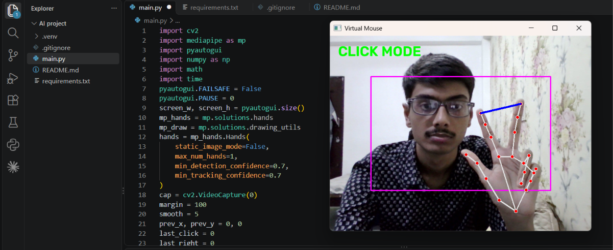

<h1 align="center">🖐️ Hand Gesture Virtual Mouse</h1>

<p align="center">
  Control your computer with just your hand, using a normal webcam.
</p>

<p align="center">
  
  
  
  
  
</p>

<p align="center">
  
</p>

---

## ✨ Features

- 🖱️ **Cursor control** with your index finger
- 👆 **Left click** by pinching two fingers together
- 👉 **Right click** with a single pinky gesture
- 📜 **Scroll** by moving your hand up and down
- 🎯 **Smooth movement** to reduce shaking
- ⚡ **Real-time** tracking of 21 hand landmarks
- 🔇 **No extra hardware**, only a webcam

---

## 🤚 Gestures

| Gesture | Action |
|:--|:--|
| ☝️ Only index finger up | Move cursor |
| ✌️ Index + middle up, bring tips together | Left click |
| 🤟 Index + middle + ring up, move hand | Scroll |
| 🤙 Only pinky up | Right click |

> Keep your hand inside the **pink box** shown on the camera window.

---

## ⚙️ How It Works

1. **OpenCV** captures frames from the webcam.
2. **MediaPipe Hands** detects 21 landmarks on the hand.
3. The code checks whether each fingertip is above its lower joint to find which fingers are up.
4. The finger pattern decides the mode: move, click, scroll or right click.
5. **PyAutoGUI** sends the real mouse action to the operating system.
6. Cursor position is mapped from the camera box to the full screen and smoothed.

---

## 🚀 Installation

```bash
# 1. Clone the repository
git clone https://github.com/ankit8567/hand-gesture-virtual-mouse.git
cd hand-gesture-virtual-mouse

# 2. Create and activate a virtual environment
python -m venv .venv
.venv\Scripts\activate

# 3. Install dependencies
pip install -r requirements.txt

# 4. Run
python main.py
```

Press **q** on the camera window to quit.

---

## 🛠️ Tech Stack

| Tool | Purpose |
|:--|:--|
| Python | Main language |
| OpenCV | Webcam capture and drawing |
| MediaPipe | Hand landmark detection |
| PyAutoGUI | Mouse control |
| NumPy | Coordinate mapping |

---

## 🔧 Tuning

| Setting | What it does |
|:--|:--|
| `smooth = 5` | Higher is smoother but slower |
| `margin = 100` | Size of the active pink box |
| `dist < 40` | Click sensitivity |

---

## 📌 Roadmap

- [ ] Drag and drop gesture
- [ ] Volume control using thumb-index distance
- [ ] Support for more hands
- [ ] Settings menu for sensitivity

---

## ⚠️ Notes

- Works best in good lighting with your palm facing the camera.
- Tested on Windows with MediaPipe 0.10.14. Newer MediaPipe versions may not include the `solutions` API used here.

---

## 👨‍💻 Author

**Ankit Srivastava**
B.Tech CSE student

[](https://github.com/ankit8567)
[](https://www.linkedin.com/in/ankit-srivastava-a65a23389)

---

<p align="center">⭐ If you like this project, give it a star!</p>